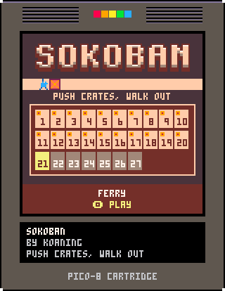
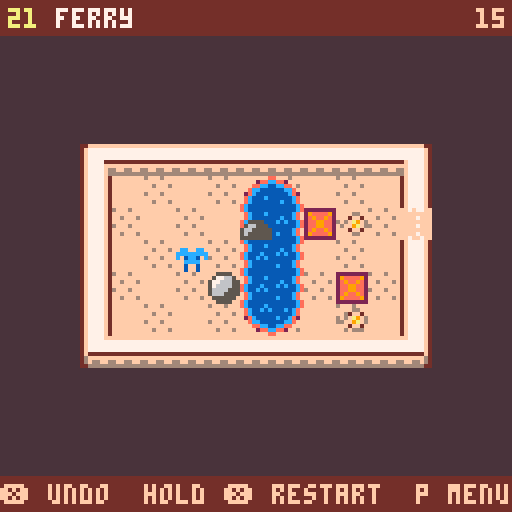

# Sokoban

A crate-pushing puzzle for **PICO-8** (128×128, 16 colours): push every crate
onto a goal, then walk out through the way out. It's a port of
[koaning/sokoban](https://github.com/koaning/sokoban): its 27 levels, its
rules (water, rocks, green switches, and a partner to work with), and its
8×8 "sandstone" look.

**Play it in your browser: <https://koaning.github.io/mazing/>**

| Cartridge | Gameplay |
| --- | --- |
|  |  |

## The rules

- **Pushing:** walk into a crate or a rock to push it one square. You can't
  pull, and you can't push two things at once.
- **The way out** opens when every crate on its side of the level is on a
  goal. Walk out through it to win. "Exit" levels have it open from the start.
- **Water:** you can't walk into it. A crate pushed into water floats on until
  it reaches land. If something solid stops it first, it stays floating and
  can't be pushed again. A rock pushed into water sinks and fills it, so you
  can walk there from then on.
- **Green switches:** while anything stands on a switch, every green wall
  flips: shut ones open and open ones shut. A green wall never shuts on
  something standing in it.
- **You and partner:** some levels have two of you. One moves at a time, and
  both have to get out.

## Controls

⬅️➡️⬆️⬇️ walk and push. 🅾️ swaps between you and partner. Tap ❎ to undo,
hold ❎ (or press R) to restart. P opens the menu. See
[pico8/README.md](pico8/README.md) for the details.

## Running it

```bash
make test        # rule tests, level solver, cart smoke test, token budget, sound check
make pico8       # run the cart in PICO-8 (pico8 on your PATH)
make serve       # play it in the browser on the preview player (run `make fetch-lovejs` once)
make screenshots # refresh docs/screenshots/ and the cart label (needs LÖVE)
```

`make test` only needs LuaJIT. More on the cart, the levels, the sound and the
preview player in [pico8/README.md](pico8/README.md).
