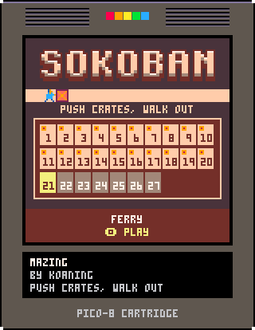
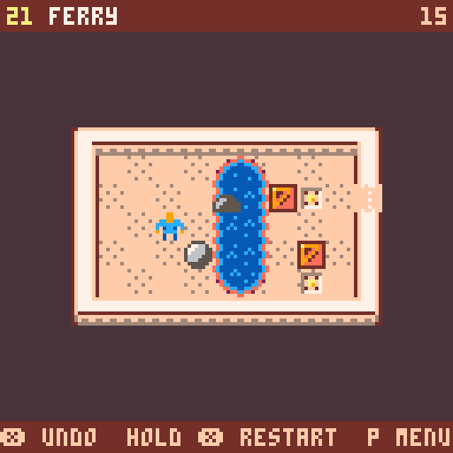

# Mazing — PICO-8 cart

| Cartridge | Gameplay |
| --- | --- |
|  |  |

```bash
pico8 -run mazing.p8     # or `make pico8` from the repo root
```

The cart is `mazing.p8`, which `#include`s:

| File | What |
| --- | --- |
| `levels.lua` | the 27 puzzles: name, board, goal |
| `rules.lua` | reading a board, walking and pushing, water, rocks, switches, the way out (ported from koaning/sokoban's `js/sokoban.js` and `js/goals.js`) |
| `main.lua` | title + level select, the level drawn from the sprite sheet, animations, undo, swapping, menu, keys, saves, sfx |

The sprites live in the cart's `__gfx__`: koaning/sokoban's 8×8 "sandstone"
design, its colours matched to PICO-8's. The cart sets a screen palette with a
few of PICO-8's extra colours for the warm sandstone and the dark plum
outside. `main.lua` lists which sprite is which. Walls and water edges are
drawn a 4×4 quarter at a time, picked by the neighbouring squares, as in the
original's renderer. Partner is You's sprites with two colours swapped.

Edit the `.lua` files in any editor. PICO-8 picks them up on `run`. To
export a standalone `.p8.png`/HTML, load the cart in PICO-8 and `save` /
`export`; includes get baked in at that point.

## Controls

- Title: ⬅️➡️⬆️⬇️ pick a level, 🅾️ play. Levels open one by one as you solve them.
- Game: ⬅️➡️⬆️⬇️ walk, and push whatever is in the way. Hold a direction to
  keep walking.
- 🅾️ swaps between you and partner on levels with two of you. The one you
  play has a little yellow marker over him.
- Tap ❎ to undo a move. Hold ❎ (or press R) to restart the level.
- P (Start on a gamepad) opens the menu: resume, restart, back to levels.
- Enter works like 🅾️ everywhere. PICO-8 normally opens its pause menu on
  Enter; the cart reads the raw keyboard (devkit mode) to tell Enter, P and R
  apart and suppresses that pause menu (`poke(0x5f30, 1)`), so its own menu
  opens instead.
- Esc belongs to PICO-8 itself when the cart runs inside the PICO-8 app
  (`make pico8`): it stops the cart and drops you into the console/editor.
  Type `resume` there (or press Ctrl+R to start over). `make play` exports a
  standalone player instead, with no editor behind it. In the browser
  preview Esc opens the menu like P.

## Levels

One string per board, rows split by `|`, the first row at the top:

```lua
{ "first push", "##>####|#@ $ .#|#######" },
{ "counterweight", "#########|#   g  _#|# $ #   #|#@  ##G##|######>#", "exit" },
```

| Char | Meaning |
| --- | --- |
| `#` / space | wall / floor |
| `$` `.` `*` | crate, goal, crate on a goal |
| `@` `+` `&` | you, you on a goal, partner |
| `>` `<` | the way out, the way in (always shut) |
| `~` `o` | water, rock |
| `_` `G` `g` | green switch, green wall shut, green wall open |

The optional third field is the goal: `"crates"` (the default, every crate on
a goal opens the way out) or `"exit"` (the way out is open from the start).
Levels must be closed by walls and fit the screen (at most 16 × 13).

`make test` solves every level with a breadth-first search (`tools/solve.lua`,
like the original's solver, including its dead-corner pruning) and fails when
a level can't be solved. The levels are koaning/sokoban's, in its order. To
add one, design it there (its editor and `make solve` check it), then copy the
board here.

## Saved progress

`cartdata("koaning_mazing")`: `dget(0)` is the highest level solved,
`dget(1..27)` is 1 once that level is solved, `dget(63)` the level played
last (the title opens on it).

## Sound

`tools/music.lua` holds everything you hear and compiles it into the cart:

- sfx 0-9, the sound effects, written as short note strings and kept soft:
  a barely-there footstep, a crate scraping, a splash, a rock sinking, a
  switch clicking, a little bell when the way out opens, undo, solved (a slow
  G major 9 arpeggio), a muted bump, and swapping to the other one.
- sfx 10+ and `__music__`: "high moor", one calm chord loop with no lead
  melody that plays all the time (pattern 0). A plucked sine harp arpeggio
  over a triangle bass.

```bash
make music   # rewrite the cart's sound data after editing the scores
```

`make test` fails if the cart's sound data is stale. The cart plays music
with `music(n, fade, 3)`, which reserves channels 0-1 so sfx always have 2-3.
If you edit the sound in PICO-8's editors instead, stop using the score
because `make music` would overwrite those edits.

## Preview player (no PICO-8 needed)

`preview/` is a small PICO-8 stand-in written in LÖVE. It reads
`mazing.p8`, resolves its `#include`s and runs the cart against a minimal
PICO-8 API: 128×128 framebuffer, the 16-colour palette and the screen
palette (with the extra colours), shapes, fill patterns, sprites from
`__gfx__` (`spr`, `sspr`, `palt`), a 3×5 font, buttons, coroutines,
`cartdata` saved in LÖVE's save folder, and a tiny synth (`preview/synth.lua`)
for the `__sfx__` and `__music__` sections.

```bash
make pico8-preview && love dist/mazing-p8.love   # desktop
make serve                                        # browser
make screenshots                                  # scripted run, see preview/shots.lua
```

`make screenshots` plays a scripted run (`preview/shots.lua`), saves
`docs/screenshots/*.png`, and writes the title screen into the cart's
`__label__` (`tools/label.lua`), which PICO-8 needs for `export`. On a
machine without a display, run it as `make screenshots LOVE="xvfb-run -a love"`.

Colours, font and sound are approximations. Use real PICO-8 to judge
how the cart looks and sounds.
